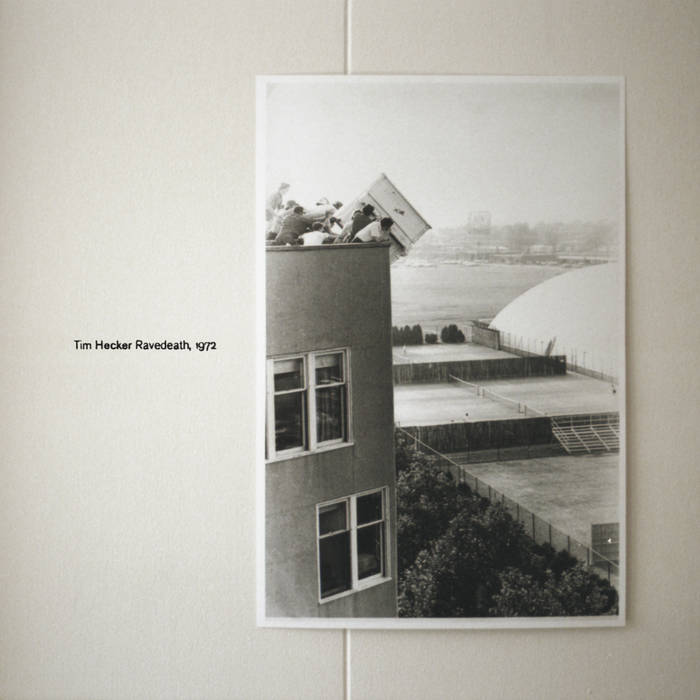

+++
title = "Ravedeath, 1972"
description = "Review of 'Ravedeath, 1972' by Tim Hecker"
date = 2026-08-03
[taxonomies]
tags = ["music"]
+++

I came across Tim Hecker's `Ravedeath, 1972` while searching for IDM albums that sounded akin to `Aphex Twin` or `Boards of Canada`. Those artists and their albums left me with a deep appreciation for music and artistry. I'll take a look at their albums also in this blog, but I wanted to focus on Tim Hecker's work first. I feel it is more straightforward to talk about this album, since this is something that is best listened to with a front-to-back mindset. That is, listening to it as a whole.

The opening track `The Piano Drop` starts off with a very oppressive arpeggiating and bassy noise that hangs during the entire length of the track. It feels as if the listener has been dropped off of a building and is slowly falling through the air. A very grim interpretation, I know, but given the title of the song, I think it's very fitting.

The album then follows up with haunting tracks that make you feel like you are on a planet that has been abandoned. No one is around. Every building you come across is empty and any sign of life is nowhere to be found. While the tracks may sound gloomy a lot of the time, there are times in certain spots in the album where a faint flicker of relief comes around and you feel this almost encouraging and I guess uplifting sense of perseverance like for example in the tracks `No Drums` and `In the Fog I`. The atmosphere is oppressive, but some respite is found. The tracks may get samey at points, which to some will feel like a bit of a drag.

The album also features a recurring sound of what sounds like a motor running. Despite the harshness of this depicted world, the engine keeps going in the background no matter what. Again to reiterate, it's a fitting theme for this LP. It tries to touch on the thought that despite life's struggles, some things keep enduring no matter what, whether for good or bad. This interpretation also ties somewhat nicely into the cover of the album. `The artwork depicts MIT students pushing a piano off the roof of the undergraduate dorm Baker House in 1972 – an act which began a long-running university ritual.` [1] 

The album then slowly ends off with the tracks 'In the Air I - III'. The songs feature piano as the leading instrument through the various noise and sounds that surround the listener. The last track then closes out the album almost on an unnoticeable whim. The piano slowly leads with a melody that somewhat abruptly fades away and you are left with this feeling of `Oh, it's gone...`

This record has been a very enjoyable and interesting listen. It comes close to my favourite albums of the IDM genre like `Music Has the Right to Children` or `Selected Ambient Works 85-92`. I will be coming back to this more as time goes on... I guess you could say sort of like a ritual.

[1]: <https://en.wikipedia.org/wiki/Ravedeath,_1972>
